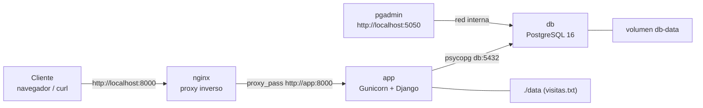

# AE4 — Aplicación Web con base de datos en contenedores

Autor: José Manuel González Hernández · Módulo DPL · UT4
Repositorio remoto: <https://github.com/Jose-Glez-Hdez/ae4>

## Arquitectura



## Puertos

| Servicio | Puerto publicado | Interno |
|---|---|---|
| nginx | 8000 | 80 |
| pgadmin | 5050 | 80 |
| app | — (no publicado) | 8000 |
| db | — (no publicado) | 5432 |

## Requisitos
- Tu equipo con Docker instalado y en marcha (versión orientativa: estable v24 o superior, Compose v2). Consulta el entorno de trabajo.
- Editor de texto, terminal y curl.
- El material de referencia de la unidad (se copia, no se construye).
- Git en el anfitrión (metodología de la UT1): la entrega es un microproyecto con su propio repositorio.

## Paso a paso

### 1. Repositorio y .gitignore
- **Qué:** Crear el repositorio del microproyecto y excluir del control de versiones lo que no debe subirse.
- **Cómo:** `git init` y un `.gitignore` que ignora `data/`, `.env`, copias de seguridad (`backup-*.sql`, `*.dump`), `__pycache__/`, `*.pyc`, `.DS_Store`, `.vscode/` y el material de referencia `ut04`.
- **Resultado:** Repositorio limpio; las credenciales (`.env`) y los datos generados nunca llegan al remoto.

### 2. Capa de datos (db/init.sql)
- **Qué:** definir el esquema y los datos iniciales de la base de datos `travelroad`.
- **Cómo:** `db/init.sql` crea la tabla `places (id, name, visited)` e inserta 11 lugares. Se monta en `/docker-entrypoint-initdb.d/` del contenedor de PostgreSQL, que lo ejecuta solo la primera vez que se inicializa el volumen.
- **Resultado:** Al arrancar `db` la tabla existe con 11 filas (`SELECT count(*) FROM places;` → `11`).

### 3. Proyecto Django
- **Qué:** Crear un proyecto Django mínimo configurable por variables de entorno.
- **Cómo:** `app/config/settings.py` lee `DJANGO_SECRET_KEY`, `DJANGO_DEBUG`, `DB_HOST`, `DB_NAME`, `DB_USER`, `DB_PASSWORD`, `DB_PORT` y `APP_DATA_DIR`. La base de datos solo se configura si existe `DB_HOST`. Dependencias en `requirements.txt`: Django 5.1, Gunicorn 23, psycopg 3 y ldap3.
- **Resultado:** La misma imagen funciona con o sin base de datos y no lleva credenciales escritas en el código.

### 4. Endpoints
- **Qué:** Exponer las rutas de la aplicación.
- **Cómo:** `app/api/urls.py` y `app/api/views.py`:

  | Ruta | Respuesta |
  |---|---|
  | `/` | Página HTML con el mensaje y el hostname del contenedor |
  | `/healthz` | `{"status": "ok"}` |
  | `/api/mensaje` | Mensaje (`APP_MENSAJE`), hostname y fecha |
  | `/api/visitas` | Contador guardado en `$APP_DATA_DIR/visitas.txt` |
  | `/api/lugares` | Filas de la tabla `places` (503 si no hay BD) |
  | `/api/login` | POST, autenticación contra LDAP (503 si falta `LDAP_HOST`) |
- **Resultado:** Todas las rutas responden JSON (salvo `/`); ver salidas en [comprobaciones.txt](comprobaciones.txt).

### 5. Imagen de la aplicación (Dockerfile)
- **Qué:** Empaquetar la aplicación en una imagen.
- **Cómo:** `app/dockerfile` parte de `python:3.12-slim`, instala las dependencias primero (para aprovechar la caché de capas), copia el código, crea el usuario sin privilegios `appuser` (UID 1000) propietario de `/data` y arranca Gunicorn con 2 workers en `0.0.0.0:8000`.
- **Resultado:** Imagen `ae4-app` que no se ejecuta como root.

### 6. Nginx como proxy inverso
- **Qué:** Que el cliente nunca hable directamente con Gunicorn.
- **Cómo:** `nginx/default.conf` escucha en el 80 y reenvía todo con `proxy_pass http://app:8000`, añadiendo las cabeceras `Host`, `X-Real-IP` y `X-Forwarded-For`.
- **Resultado:** la aplicación solo es accesible a través de nginx en `http://localhost:8000`.

### 7. compose.yml
- **Qué:** Declarar los cuatro servicios y cómo se relacionan.
- **Cómo:**
  - `db`: `postgres:16-alpine`, volumen `db-data`, `init.sql` en solo lectura y healthcheck con `pg_isready`.
  - `pgadmin`: `dpage/pgadmin4:9.17` en el 5050, volumen `pgadmin-data` y healthcheck a `/misc/ping`.
  - `app`: se construye desde `./app`, recibe las variables de BD y usa el volumen `app-data` en `/data`; healthcheck a `/healthz`.
  - `nginx`: `nginx:1.27-alpine` en el 8000 con `default.conf` montado en solo lectura.
  - Orden de arranque con `depends_on: condition: service_healthy` (db → app → nginx; db → pgadmin) y `restart: unless-stopped` en todos.
- **Resultado:** `docker compose up -d` levanta la pila completa en el orden correcto.

### 8. Despliegue y pruebas
- **Qué:** Comprobar que la pila funciona de extremo a extremo.
- **Cómo:** `docker compose ps` y `curl` contra `/`, `/healthz`, `/api/mensaje` y `/api/lugares`.
- **Resultado:** Los cuatro contenedores en `Up` (`db`, `app` y `pgadmin` como `healthy`); `/healthz` devuelve `{"status": "ok"}` y `/api/lugares` devuelve `"total": 11`.

### 9. pgAdmin
- **Qué:** Administrar PostgreSQL desde el navegador sin configurar el servidor a mano.
- **Cómo:** En `compose.yml` se define un `config` inline (`pgadmin-servers`) que se monta como `/pgadmin4/servers.json` y registra el servidor **TravelRoad** (host `db`, puerto 5432, usuario `alumno`).
- **Resultado:** En `http://localhost:5050` aparece ya el servidor TravelRoad; `curl http://localhost:5050/misc/ping` → `PING`.

### 10. Persistencia y variables de entorno
- **Qué:** Que los datos sobrevivan a reinicios y que las credenciales queden fuera del repositorio.
- **Cómo:** Volúmenes con nombre `db-data`, `pgadmin-data` y `app-data`. Las contraseñas (`DB_PASSWORD`, `PGADMIN_EMAIL`, `PGADMIN_PASSWORD`) se leen de `.env`, que está en `.gitignore`.
- **Problema encontrado:** Con un bind mount `./data:/data`, `/api/visitas` devolvía **500**: la carpeta del anfitrión pertenecía a root y el contenedor, que corre como `appuser`, no podía escribir `visitas.txt`. Se sustituyó por el volumen con nombre `app-data`, que hereda los permisos de `/data` creados en el Dockerfile.
- **Resultado:** Tras `docker compose restart app` el contador continúa (8 → 9) y tras `docker compose restart db` la tabla sigue con 11 filas.

### 11. deploy.sh
- **Qué:** Automatizar el despliegue con un solo comando.
- **Cómo:** El script ejecuta `docker compose build` y `docker compose up -d`, y después consulta `/healthz` hasta 30 veces cada 2 s. Si no responde en 60 s muestra `docker compose ps` y los últimos logs y termina con código 1.
- **Resultado:** `./deploy.sh` → `Despliegue correcto tras 1 intento(s).` y código de salida 0.

### 12. Comprobaciones
- **Qué:** Dejar evidencia de que todo funciona.
- **Cómo:** Se guardó la salida real de cada prueba en [comprobaciones.txt](comprobaciones.txt).
- **Resultado:** El fichero recoge `docker compose ps`, los `curl` a los endpoints, el recuento de `places`, el ping de pgAdmin, las pruebas de persistencia y la ejecución de `deploy.sh`.

## Cómo desplegar
```bash
./deploy.sh
```

## Credenciales
Todas las credenciales se aportan mediante variables de entorno.

## Limpieza
`docker compose down` (conserva datos) · `docker compose down -v` (borra los volúmenes)